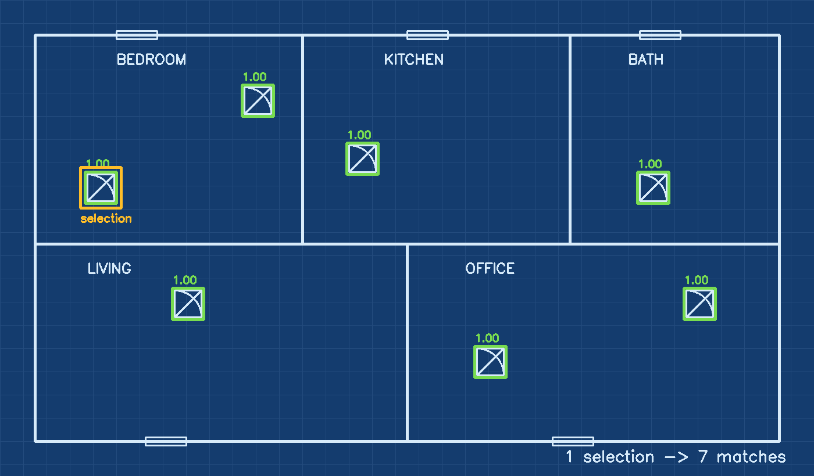

# DeepZoom Template Matching

[](https://github.com/mo9tada/deepzoom-template-matching/actions/workflows/ci.yml)


**Select one symbol on a huge blueprint, find every other occurrence in seconds.**

Counting doors, outlets or valves on a large architectural or engineering drawing is slow and error-prone by hand. This app lets you pan and zoom through blueprint-sized images in the browser, draw a box around one symbol, and get back every matching symbol on the sheet with a confidence score.



*Output of the matcher on a sample floor plan: one selection (orange), seven matches (green). Generated by the service in this repo.*

## How it works

```
 Browser (Next.js + OpenSeadragon)        Next.js API route              Python service (FastAPI + OpenCV)
 ┌─────────────────────────────┐   POST   ┌──────────────────────┐  POST  ┌──────────────────────────────────┐
 │ deep-zoom viewer             │ ───────► │ /api/match-selection │ ─────► │ /match-selection                 │
 │ user draws a selection box   │          │ validate + forward   │        │ 1. crop template from selection  │
 │ matches drawn as overlays    │ ◄─────── │ timeout handling     │ ◄───── │ 2. same preprocessing both sides │
 └─────────────────────────────┘          └──────────────────────┘        │ 3. multi-scale / rotation search │
                                                                          │ 4. non-max suppression           │
                                                                          └──────────────────────────────────┘
```

- **Viewer** — [OpenSeadragon](https://openseadragon.github.io/) renders very large images as Deep Zoom tiles, so a 10,000 px drawing stays smooth.
- **Normalised coordinates** — the browser sends the selection as 0–1 fractions of the image, so the backend is independent of the zoom level.
- **Matching** — OpenCV normalised cross-correlation (`TM_CCOEFF_NORMED`) at several scales and rotations. Three modes: `auto`, `linework` (Canny edges, best for line drawings) and `texture`.
- **Large-image safety** — the search area is downscaled above 1,600 px and hit counts are capped per pass to keep latency bounded.
- **De-duplication** — non-max suppression with a configurable IoU threshold turns thousands of raw hits into one box per symbol.
- **Offline fallback** — a TensorFlow.js model in the browser can run when the Python service is unreachable.

## Quick start

**1. Start the matcher** (Docker):

```bash
docker compose up --build        # serves http://localhost:8000
```

or with Python:

```bash
cd python-matcher
python -m venv .venv && source .venv/bin/activate   # Windows: .venv\Scripts\activate
pip install -r requirements.txt
uvicorn app:app --port 8000 --reload
```

**2. Start the web app:**

```bash
npm install
cp .env.example .env.local
npm run dev                      # http://localhost:3000 → Detect page
```

| Variable | Default | Purpose |
| --- | --- | --- |
| `PY_MATCHER_URL` | `http://127.0.0.1:8000` | Base URL of the matcher service |
| `PY_MATCHER_TIMEOUT_MS` | `60000` | Request timeout for large searches |
| `NEXT_PUBLIC_TEMPLATE_MATCH_THRESHOLD` | `0.82` | Similarity above which a match is badged as confident |

## API

`POST /match-selection`

```json
{
  "image": "data:image/png;base64,...",
  "coordinates": { "x": 0.10, "y": 0.36, "width": 0.04, "height": 0.07 },
  "options": { "mode": "linework", "min_similarity": 0.6, "scales": [0.85, 1.0, 1.2], "nms_iou": 0.35 }
}
```

Returns `matches` (label, confidence, normalised bounding box), per-pass `stats` (candidates, kept hits, duration) and `bestSimilarity`. Interactive docs are served at `http://localhost:8000/docs`. `GET /health` is used by the Docker health check.

## Testing and CI

```bash
cd python-matcher && pip install -r requirements-dev.txt && pytest -v
```

The tests draw a synthetic blueprint with known symbol positions plus a distractor, then assert that every copy is found and the distractor is not. They also cover IoU, non-max suppression, coordinate clamping and decoding of RGB, RGBA, grayscale and palette PNGs.

GitHub Actions runs on every push: TypeScript type check and production build, the Python test suite, and a Docker image build.

## Deployment

- Deploy the matcher as a container (any VM, Cloud Run, Fly.io, Render) and set `PY_MATCHER_URL` to its HTTPS origin.
- Deploy the Next.js app on Vercel. All image processing lives in the Python service, so the Node runtime stays lightweight.

## Troubleshooting

- **Timeouts** — raise `PY_MATCHER_TIMEOUT_MS` for very large searches or slow hardware.
- **Selection drift** — the image sent to the matcher must be the same one shown in the viewer (no extra compression or cropping), because coordinates are normalised.

## Author

Built by **Moktada Zaidi** — [GitHub](https://github.com/mo9tada)
